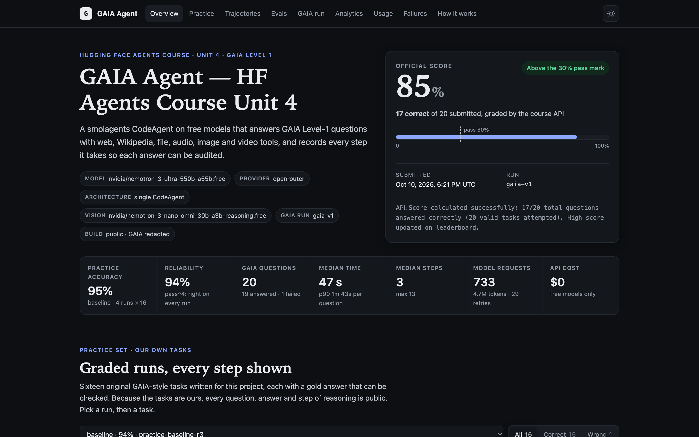
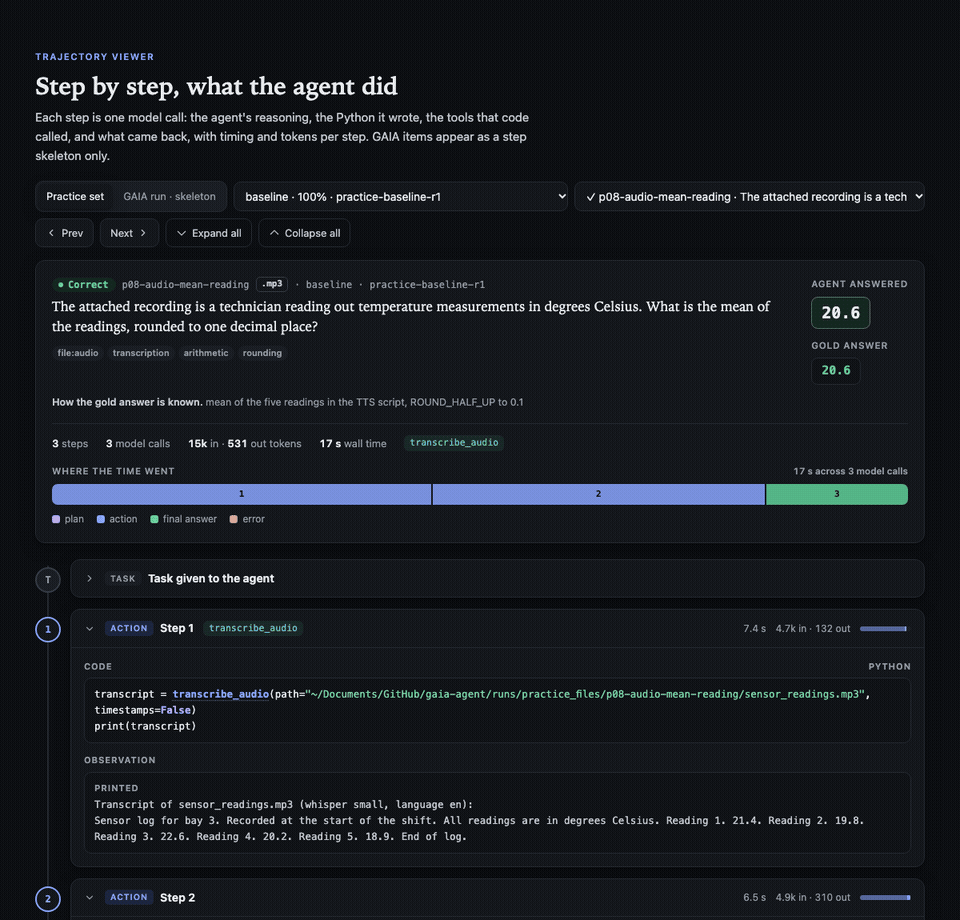
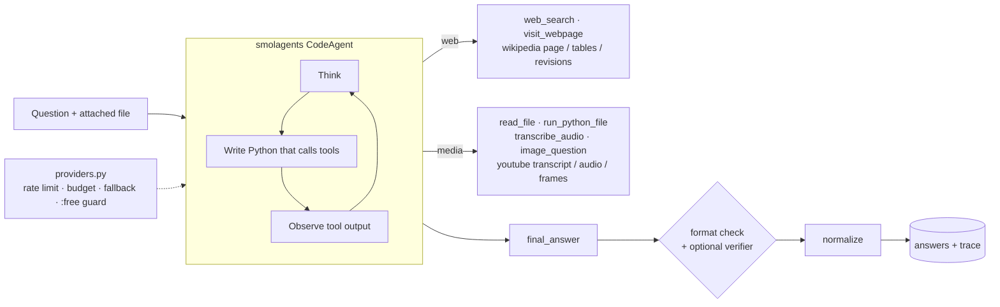

# GAIA Agent

**A research agent, with the tracing, evals and reliability work it takes to trust one.** Built for the final assignment (Unit 4) of the [Hugging Face Agents Course](https://huggingface.co/learn/agents-course): 20 Level-1 questions from the [GAIA benchmark](https://huggingface.co/papers/2311.12983), graded by exact match. It runs entirely on **free, open-weight models**: every model it uses has its weights published on Hugging Face.

<!-- RESULTS:START -->
| | |
|---|---|
| **Official score** (course API, 20 GAIA L1 questions) | **85% (17 / 20)**: the certificate bar is 30% |
| **Practice set** (16 original tasks, 4 identical runs) | **95.3% mean accuracy · pass@4 100% · pass^4 93.8%** |
| **Models · cost** | **Open-weight only** (NVIDIA Nemotron 3 Ultra, Nemotron 3 Nano Omni, dots-3), served free via OpenRouter: **$0**, enforced in code |
<!-- RESULTS:END -->

**Results site:** step-by-step replays of every practice task, tool usage, latency, failure tags and ablations: **[bakulbadwal.github.io/gaia-agent](https://bakulbadwal.github.io/gaia-agent/)**

[](https://bakulbadwal.github.io/gaia-agent/)



*Every answer can be audited: the trajectory viewer replays each step the agent took (the Python it wrote, what each tool returned, and the time and tokens it cost), next to the gold answer.*

---

## Why this one is different

Most Unit 4 submissions are one agent, one run and one score. This project treats the agent as something that will be deployed, so it measures it the way a production team would.

| | What it does | Why it matters |
|---|---|---|
| **Observability** | Every run writes a full trace: each step's reasoning, the Python it wrote, every tool call and its result, tokens and timing. Sub-agent calls are captured too, which smolagents doesn't keep on its own (it resets a managed agent's memory on every call). | You can't fix what you can't see. Each failure below was diagnosed from a trace, not guessed. |
| **Its own eval suite** | A 16-task practice set I wrote, with verifiable gold answers and input files built from scratch (spreadsheets, CSV, JSON, PDF, audio, a chess diagram, Python files, multi-hop Wikipedia). It is scored with a line-for-line port of GAIA's official quasi-exact scorer. | The course API returns one number and never says which answers were right. A local set with known answers is the only way to improve without overfitting the benchmark. |
| **Reliability, not just accuracy** | Every task is run 4 times (the fourth doubles as the ablation baseline), and the report shows **pass@k** (solved at least once) and **pass^k** (solved every time). | A demo needs one lucky run. A deployment needs pass^k. The gap between the two numbers is where the flakiness hides. |
| **Ablations** | The same set is re-run with web tools removed, media tools removed, a manager + specialists architecture, and a format-verifier pass. | It shows what each piece is actually worth, instead of asserting it. |
| **Running on free endpoints** | A token-bucket rate limiter and a daily request budget. Backoff that respects `Retry-After`. Fallback chains when a model returns an empty reply or a 429. A per-call usage log. A **`:free`-only guard** that refuses any billable model id before a request is sent. | Free tiers are flaky. This is the plumbing that turns flaky into finishes. |
| **Contamination policy** | A guard in the agent's web tools blocks GAIA answer pages, and nothing is hard-coded. The public repo and site never publish the GAIA questions or the agent's answers to them, because the dataset asks that its items not be reshared in crawlable form. | A score is only worth something if it wasn't looked up. |

## How it works



- **The agent** is a smolagents 1.26 `CodeAgent`. It acts by writing Python, so it can loop, filter a DataFrame and call three tools in one step, instead of one JSON tool call per round trip. The system prompt carries GAIA's answer rules: numbers without units or separators, minimal strings, comma lists, and the question's own format instructions.
- **Multi-agent mode** (`GAIA_ARCH=multi`) uses a manager that delegates to a `web_researcher` and a `media_analyst`, each with only its own tools.
- **Verifier mode** (`GAIA_VERIFY=1`) adds one extra call that may only *reformat* the answer, never re-research it. Its output is accepted only if it passes a pure-reformat check.
- **Models (all open-weight):** NVIDIA [Nemotron 3 Ultra](https://huggingface.co/nvidia/NVIDIA-Nemotron-3-Ultra-550B-A55B-BF16) (550B total, 55B active) for reasoning; [Nemotron 3 Nano Omni](https://huggingface.co/nvidia/Nemotron-3-Nano-Omni-30B-A3B-Reasoning-BF16) or [dots-3](https://huggingface.co/dots-studio/dots3-note-prev) for images and video frames. They're served free through OpenRouter, and each falls back to the next free model in its chain. Anyone could self-host the exact same weights.

### Tools (13)

| Web | Media and files |
|---|---|
| `web_search`: DuckDuckGo, with GAIA results filtered out | `read_file`: xlsx, csv, json, pdf, txt, py (every sheet as a markdown table, with dtypes) |
| `visit_webpage`: HTML or PDF to markdown, paged | `run_python_file`: runs an attached script in a subprocess |
| `wikipedia_search` | `transcribe_audio`: local Whisper (faster-whisper), cached |
| `wikipedia_page`: rendered page **with tables**, by section | `image_question`: the vision model, with chess-specific prompting |
| `wikipedia_revision`: the page as it stood on a past date | `youtube_transcript`: captions, with rolling-caption dedupe |
| `wikipedia_page_info`: talk page, quality status, creation date | `youtube_audio_transcript` · `youtube_frames_question` (frames to the vision model) |

## Results

<!-- DETAIL:START -->
All runs are from 2026-10-10 and used free, open-weight models only (served via OpenRouter). Total model spend: **$0.00**.

### Official GAIA score: 85% (17 / 20)

| | |
|---|---|
| Questions | 20 GAIA Level-1 validation questions, from the course API |
| Correct | **17** (the certificate needs 6) |
| Steps per question | mean 4.35 · median time 47 s · p90 91 s |
| Model calls | 148 for the whole run, including vision calls and the 5 attachment re-runs; 4 retries |
| Most-used tools | `visit_webpage` 24 · `web_search` 17 · `image_question` 6 · `read_file` 4 |

The course API returns only an aggregate score, so it doesn't reveal which three answers were wrong. One is known: the **chess-diagram question** timed out after free vision models took up to 6 minutes per image. The practice set's chess task (below) is the same weakness: it's the only task that failed across repeats.

**Found in the traces, then fixed:** in the first pass, all 5 attachment questions failed because the course's file endpoint returns 404. Each of them burned all 12 steps hunting for a file that wasn't there. The fix was general: a missing input now tells the agent to stop and answer `unknown` (a regression test covers it). The attachments were then fetched from the GAIA dataset by exact file name, never touching its answer metadata.

### Reliability: same agent, same 16 tasks, 4 runs

| | Run 1 | Run 2 | Run 3 | Run 4 | **pass@4** | **pass^4** |
|---|---|---|---|---|---|---|
| Accuracy | 100% | 93.8% | 93.8% | 93.8% | **100%** | **93.8%** |

The 16 practice tasks, their input files and gold answers are published as a dataset: **[bacool/gaia-agent-practice-set](https://huggingface.co/datasets/bacool/gaia-agent-practice-set)**.

Run 4 is the ablation's baseline: the same configuration, run again. 15 of 16 tasks were solved on every run. The only flaky one was reading a chess diagram (1 of 4). pass^k (all k runs correct) is the number that matters if someone depends on the agent.

### Ablations: what each piece is worth

| Config | Accuracy | Tokens / task | Time / task | Takeaway |
|---|---|---|---|---|
| **Baseline** (single CodeAgent) | 93.8% | 20.5k | 54 s | |
| No media tools | **68.8%** (−25 pts) | 42.2k | 165 s | Lost both audio tasks, the chart and one code task, and burned 2× the tokens trying |
| No web tools | 93.8% | 15.9k | 95 s | No drop, because the model already knew these 4 Wikipedia answers. The practice set's web tasks are memorizable, so they don't test retrieval; GAIA's lookups do |
| Manager + 2 specialists | 93.8% | 30.2k | 130 s | **+47% tokens and 2.4× the latency for no accuracy gain.** At this task size, the simplest architecture wins |
| Format verifier | 93.8% | 24.0k | 98 s | No gain. The normalizer already handles format |

With 16 tasks, one task is 6.25 points, so none of these differences is statistically significant on its own (paired McNemar test; the media-tools drop has p = 0.125). They're directional evidence, and that's how they're reported here.

Full per-skill breakdown: [`evals/results/ablation_2026-10-10.md`](evals/results/ablation_2026-10-10.md). The results site has every practice trajectory, step by step.
<!-- DETAIL:END -->

## Run it

```bash
uv venv .venv --python 3.12 && uv pip install --python .venv/bin/python -r requirements.txt
echo "OPENROUTER_API_KEY=sk-or-..." >> ~/.claude/.env   # or export it; any free OpenRouter key works

python run.py                                   # answer the 20 Unit 4 questions (resumable, traced)
python submit.py                                # dry run: shows the payload
python submit.py --yes                          # submit to the course API
python evals/run_practice.py --repeat 3         # practice set, scored, pass^k
python evals/ablate.py                          # ablation table
python report/build_report.py                   # rebuild the results site (public redaction is on by default)
python -m pytest -q -m "not network"            # 396 offline tests
```

| Setting | Effect |
|---|---|
| `GAIA_PROVIDER` | `openrouter` (default when its key is set) · `gemini` · `groq` · `lmstudio` (local) |
| `GAIA_ARCH` | `single` (default) · `multi` (manager + specialists) |
| `GAIA_VERIFY=1` | format-verifier pass |
| `GAIA_DISABLE_TOOLS` | comma list of tools to remove (ablations) |
| `GAIA_MODEL_ID` / `GAIA_VISION_MODEL_ID` | override the model chains |
| `GAIA_ALLOW_PAID` | off by default: non-`:free` model ids are refused |

## Repository layout

```
gaia_agent/   agent, tools_web, tools_media, providers (+ presets), trace, files, run, submit
evals/        scorer (GAIA port), practice set + generator, run_practice, passk, ablate, configs
analysis/     error_analysis: automatic failure tags per trace
report/       static results-site generator  →  docs/ (GitHub Pages)
tests/        396 offline + 18 network tests
app.py        Hugging Face Space (the course template, wired to this agent)
```

## Design decisions

| Decision | Why | Trade-off |
|---|---|---|
| **CodeAgent over JSON tool calls** | Code can filter, loop and combine tools in one step, so there are fewer round trips on a rate-limited free tier ([Wang et al., 2024](https://huggingface.co/papers/2402.01030)). | Running model-written code needs a sandbox: smolagents' restricted executor, a code-level network guard, and timeouts. |
| **Free, open-weight models only** | Shows the agent design carrying the result, not a frontier API, and keeps it reproducible: the weights are public. | Free endpoints return empty replies and 429s, so the fallback chains do real work, and the score has a lower ceiling. |
| **Local Whisper for audio** | Free, private, and cached. | CPU transcription is slower than an API. |
| **Fix timeouts once, generally** | The live test found that smolagents' 30 s code-step timeout was silently throwing away slow-but-successful tool calls. The fix raised the limit for every step (300 s; 1,200 s for a manager waiting on a specialist), bounded by a per-question watchdog. | A truly stuck step takes longer to cut off. |
| **Redacted public results** | GAIA asks that its items not be reshared, so they aren't. | The public GAIA trajectories show only each step's skeleton. Full replays are shown for the practice set instead. |

## Limitations

- The course's file endpoint (`GET /files/{task_id}`) returned **404 for all 5 attachment questions** on 2026-10-10, so those 5 can't be answered from the course API. The agent supports fetching just those attachments from the gated GAIA dataset (`GAIA_ATTACHMENTS_FROM_HUB=1`) once access is granted, and never reads the dataset's answer metadata.
- The practice set is 16 tasks: a regression suite, not a benchmark. Its numbers aren't comparable to GAIA's.
- Free-model outputs change over time, so a re-run won't reproduce these exact numbers. The traces record what happened on each run.

## Credits

The [Hugging Face Agents Course](https://github.com/huggingface/agents-course) (Unit 4 and its Space template) · [smolagents](https://github.com/huggingface/smolagents) · [GAIA](https://huggingface.co/papers/2311.12983) (Mialon et al., 2023) and its leaderboard scorer · free models served by [OpenRouter](https://openrouter.ai) (NVIDIA Nemotron, dots, Gemma).

Built by [Bakul Badwal](https://github.com/bakulbadwal) (UVA Darden MBA '27) with Claude Code. MIT License.
